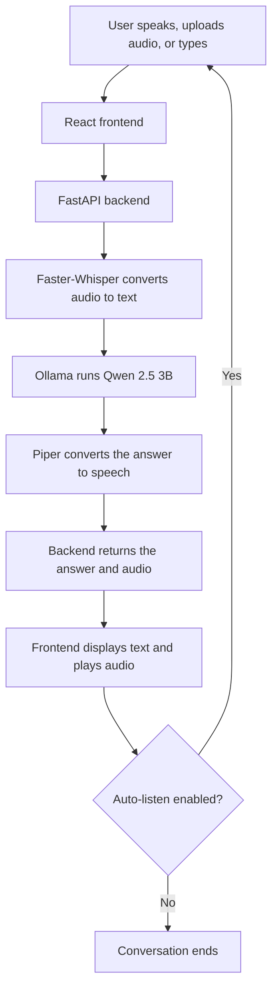

# VoiceX AI

**A real-time voice assistant for English and Hindi.**

VoiceX AI lets you speak with an AI assistant through a web browser. It captures speech, converts it to text, generates a response, and reads the response aloud. The application includes a React frontend and a FastAPI backend, with local speech and language models.

> This project was developed as an internship project.

## Demo

Place the project demonstration video at `video/voicex-ai-demo.mp4`.

<video src="video/voicex-ai-demo.mp4" controls width="720">
  Your browser does not support embedded videos.
  <a href="video/voicex-ai-demo.mp4">Open the VoiceX AI demo video</a>.
</video>

## What it does

- Accepts spoken questions from a microphone, audio files, or text.
- Transcribes speech with Faster-Whisper.
- Generates answers using Qwen 2.5 3B through Ollama.
- Speaks answers using Piper text-to-speech.
- Supports English and Hindi, conversation history, and hands-free follow-up.

## System workflow



### Workflow steps

1. The user speaks, uploads an audio file, or enters a text message.
2. The frontend records audio and sends it to the backend. Typed messages are sent directly.
3. Faster-Whisper transcribes audio into text.
4. The backend sends the message and recent conversation context to Qwen through Ollama.
5. Piper generates speech from the assistant's response.
6. The frontend displays the response and plays the audio.
7. If auto-listen is enabled, the microphone starts listening for the next question.

## Technologies

| Part | Technology |
| --- | --- |
| Frontend | React, TypeScript, Vite |
| Backend | Python, FastAPI |
| Speech recognition | Faster-Whisper |
| Language model | Ollama with Qwen 2.5 3B |
| Speech synthesis | Piper |

## Requirements

- Windows
- Python 3.10 or 3.11
- Node.js and npm
- [Ollama](https://ollama.com)
- Microphone and a supported web browser

The models require several gigabytes of disk space. Internet access is needed for the initial setup and model downloads.

## Run the project on Windows

1. Install Ollama, then download the language model:

   ```powershell
   ollama pull qwen2.5:3b
   ```

2. From the project folder, run:

   ```powershell
   .\start.bat
   ```

   On the first run, the launcher installs the Python and frontend dependencies and downloads the Piper voices.

3. Open the frontend at [http://localhost:3000](http://localhost:3000).

4. To stop the services, run:

   ```powershell
   .\stop.bat
   ```

Allow microphone access when your browser asks. The backend API is at [http://127.0.0.1:8001](http://127.0.0.1:8001), and its interactive documentation is at [http://127.0.0.1:8001/docs](http://127.0.0.1:8001/docs).

## Run services manually

Start Ollama and make sure the model is available:

```powershell
ollama serve
ollama pull qwen2.5:3b
```

In a terminal, start the backend:

```powershell
cd Backend
python -m venv .venv
.\.venv\Scripts\Activate.ps1
python -m pip install -r requirements.txt
Copy-Item .env.example .env
python scripts\download_piper_models.py
python -m uvicorn app.main:app --host 127.0.0.1 --port 8001 --reload
```

The `.env.example` files contain shareable configuration templates. Copy one to `.env` for local settings; real `.env` files are ignored by Git and should not be committed.

In a second terminal, start the frontend:

```powershell
cd Frontend
npm install
npm run dev
```

Then visit [http://localhost:3000](http://localhost:3000).

## Project structure

```text
.
├── Backend/
│   ├── app/
│   │   ├── api/          # HTTP API routes
│   │   ├── core/         # Configuration and device setup
│   │   ├── schemas/      # API data models
│   │   └── services/     # Speech, language model, and conversation logic
│   ├── models/piper/     # Piper voice models
│   └── requirements.txt
├── Frontend/
│   └── src/
│       ├── components/   # User interface
│       ├── context/      # Voice state and workflow
│       └── services/     # API and audio capture
├── video/                # Project demonstration video
├── start.bat
├── stop.bat
└── README.md
```

## Main API endpoints

| Method | Endpoint | Purpose |
| --- | --- | --- |
| `GET` | `/api/health` | Check backend status |
| `POST` | `/api/transcribe` | Transcribe an uploaded audio file |
| `POST` | `/api/chat` | Generate an assistant response |
| `POST` | `/api/tts` | Generate speech audio |
| `GET` | `/api/conversations` | Get conversation sessions |

See [http://127.0.0.1:8001/docs](http://127.0.0.1:8001/docs) for the full API documentation while the backend is running.

## Privacy note

By default, speech recognition, chat, and speech generation run locally. If Edge-TTS is configured instead of Piper, text sent for speech synthesis is processed by Microsoft's online service. Conversation data is stored in the browser and in the backend's in-memory session store.

## Limitations

- The assistant is designed for English and Hindi.
- Conversation sessions in the backend are cleared when the backend restarts.
- The WebSocket route is not a live streaming pipeline; voice turns use HTTP requests.
- The Windows launcher scripts are specific to Windows.
